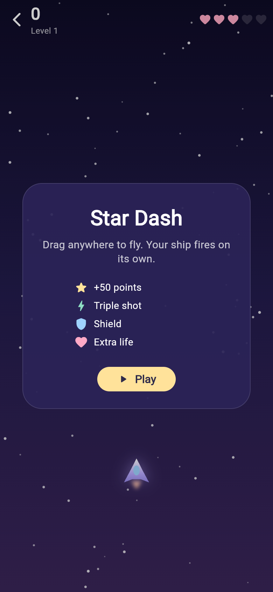
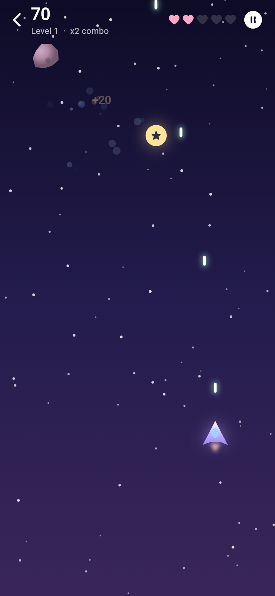

# Calm Pop 🌿

A small, friendly stress-relief app built with Flutter. An arcade space shooter plus four calming mini games, soft pastel UI, haptic feedback, no ads, no sign-up, works offline.

| Home | Bubble Wrap | Breathe | Ripple Pond | Fidget Spinner |
|---|---|---|---|---|
|  |  |  |  |  |

| Star Dash | Star Dash (playing) |
|---|---|
|  |  |

## Games

- **Star Dash (arcade)** – drag to fly your ship; it fires on its own. Blast asteroids (big ones split in two), build combos, and grab power-ups: ⭐ +50 points, ⚡ triple shot, 🛡 shield, ❤ extra life. It speeds up every level, and your best score is saved.

- **Bubble Wrap** – tap bubbles to pop them (with a click and a vibration). A new sheet in a new colour appears when you finish one.
- **Breathe** – a guided breathing circle with three patterns: Calm (4-6), Box (4-4-4-4) and Relax (4-7-8).
- **Ripple Pond** – tap or swipe the night-time pond to make glowing coloured ripples.
- **Fidget Spinner** – flick the spinner and watch it coast down. Tracks RPM, spins and your best speed. Tap the palette to change its colour.

The home screen also shows a calming tip. Tap it to see another one.

## Get the APK

**From GitHub (no setup needed):** every push that changes `calm_pop/` runs the
**Build Calm Pop APK** workflow. Open the repo's **Actions** tab → latest run →
download the `calm-pop-apk` artifact, unzip it, and install `app-release.apk` on
your phone (allow "install unknown apps" when Android asks). You can also start
the workflow by hand with **Run workflow**.

**Build locally:**

```bash
cd calm_pop
flutter pub get
flutter build apk --release
# APK: build/app/outputs/flutter-apk/app-release.apk
```

Or plug in a phone and run `flutter run`.

> The release build is signed with the debug key so it installs straight away.
> Before publishing to the Play Store, set up your own signing key
> (see https://docs.flutter.dev/deployment/android).

## Project layout

```
lib/
  main.dart              app entry + theme
  theme.dart             pastel colour palette
  home_screen.dart       greeting, tip card, game grid
  widgets/game_scaffold.dart  shared header + stat pills
  games/
    star_dash.dart
    bubble_wrap.dart
    breathe.dart
    ripple_pond.dart
    fidget_spinner.dart
```

The only package used is `shared_preferences` (to save the Star Dash best score). Everything is drawn with Flutter widgets and `CustomPainter`.
