# Calm Pop 🌿

A small, friendly stress-relief app built with Flutter. An arcade space shooter, a cozy fairy game, plus four calming mini games, soft pastel UI, haptic feedback, no ads, no sign-up, works offline.

| Home | Bubble Wrap | Breathe | Ripple Pond | Fidget Spinner |
|---|---|---|---|---|
| 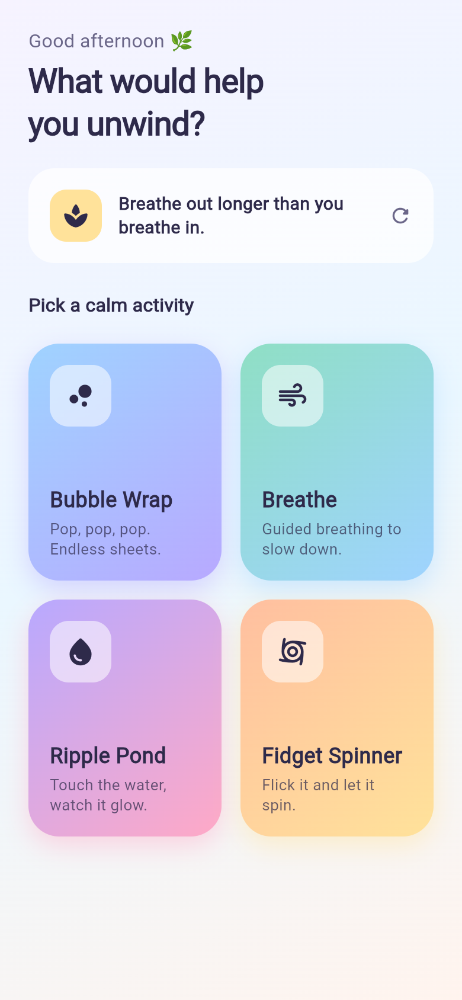 | 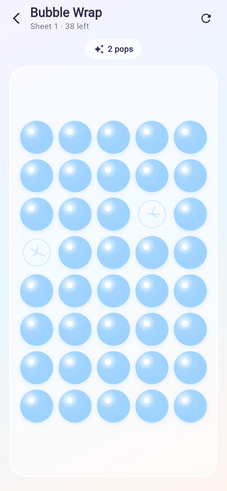 | 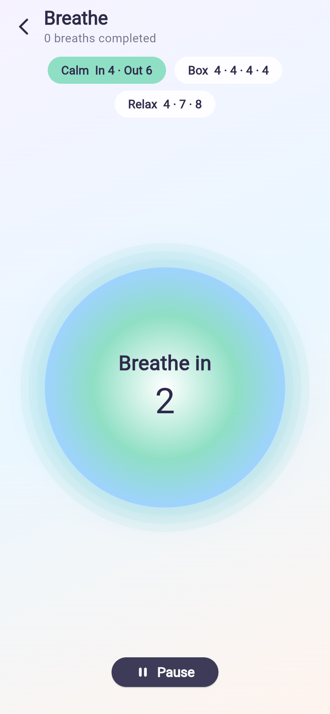 | 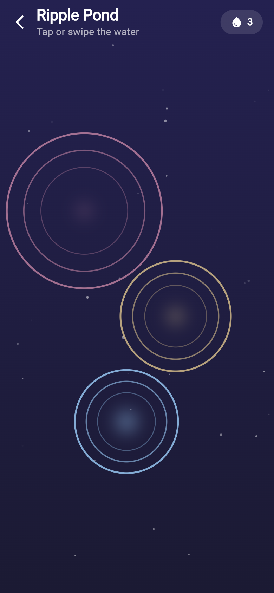 | 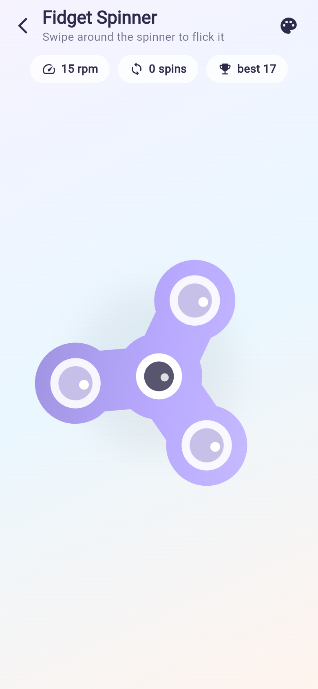 |

| Galaxy map | UFOs | Grumbo | Mothership Omega | Hangar |
|---|---|---|---|---|
| 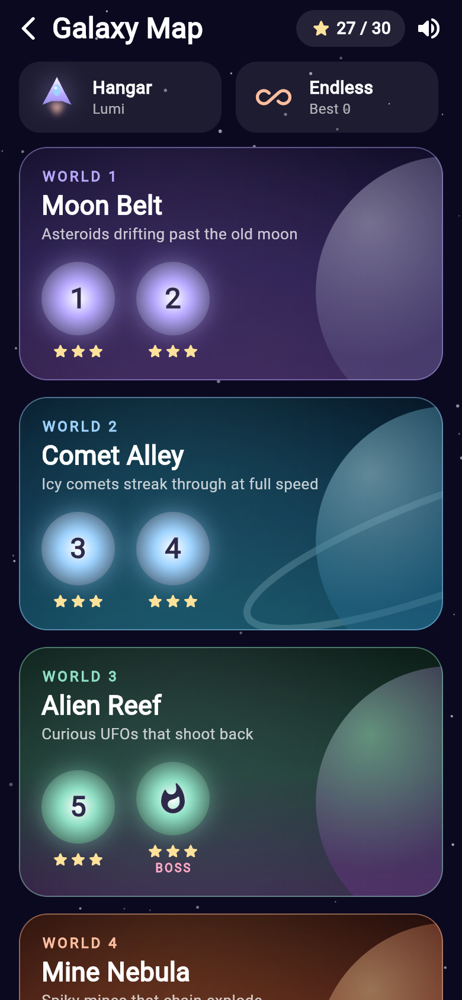 | 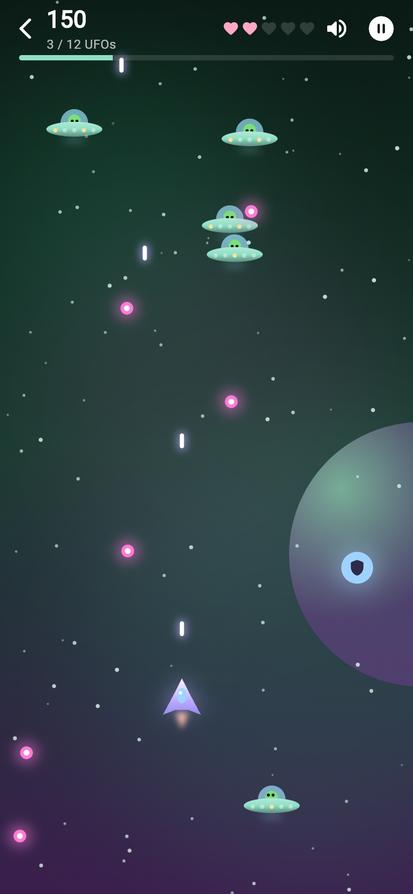 | 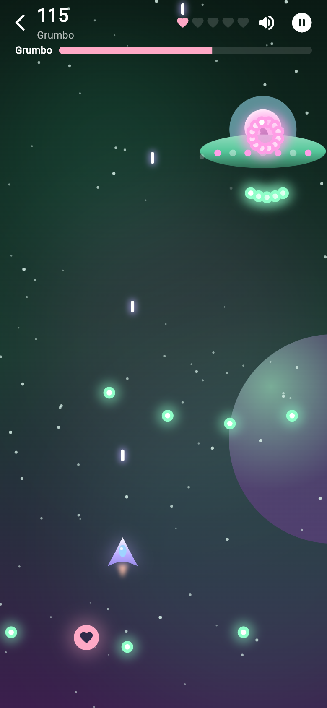 | 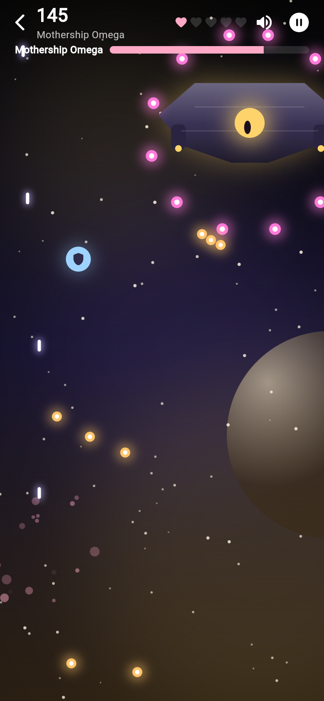 | 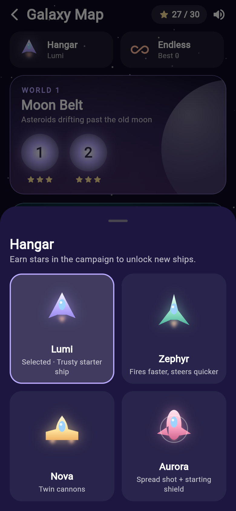 |

| Fairy Glow | Fairy Glow (playing) |
|---|---|
| 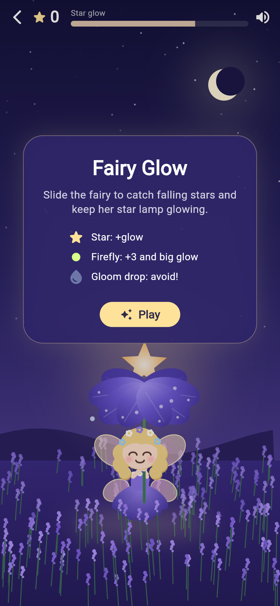 | 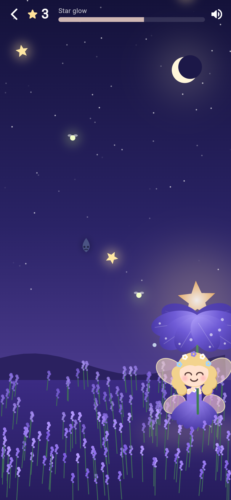 |

## Games

- **Star Dash (arcade)** – a space-shooter campaign. Drag to fly; your ship fires on its own.
  - **Galaxy map:** 5 worlds, 10 levels, each with its own look and goal (destroy N enemies, survive, collect star crystals, beat the boss). Earn 1–3 stars per level depending on lives lost; the next level unlocks when you clear one.
  - **Worlds and enemies:** Moon Belt (asteroids that split), Comet Alley (fast comets with icy tails), Alien Reef (UFOs with little aliens that shoot back), Mine Nebula (spiky mines that chain-explode), Void Core (everything at once).
  - **Bosses:** *Grumbo*, a giant one-eyed UFO (level 6), and *Mothership Omega* (level 10), which has three phases: aimed bursts, then minion UFOs, then a sweeping laser beam.
  - **Hangar:** unlock ships with stars: Lumi, Zephyr (faster fire), Nova (twin cannons) and Aurora (spread shot + starting shield).
  - **Power-ups:** star crystal, power shot, shield, extra life and Mega Bomb. **Endless mode** keeps your best score.
  - Siren, victory fanfare and boss music.

- **Fairy Glow (cozy)** – a little fairy shelters under a purple flower umbrella topped with a glowing star, in a lavender meadow at night. Slide her to catch falling stars (each one in a row plays the next note), grab fireflies for a big boost, and dodge gloom drops. The star lamp slowly dims, so keep catching! Music-box lullaby, best score saved. The fairy is drawn entirely in code.
- **Bubble Wrap** – tap bubbles to pop them (with a click and a vibration). A new sheet in a new colour appears when you finish one.
- **Breathe** – a guided breathing circle with three patterns: Calm (4-6), Box (4-4-4-4) and Relax (4-7-8).
- **Ripple Pond** – tap or swipe the night-time pond to make glowing coloured ripples.
- **Fidget Spinner** – flick the spinner and watch it coast down. Tracks RPM, spins and your best speed. Tap the palette to change its colour.

The home screen also shows a calming tip. Tap it to see another one.

## Sound

Every game has sound effects: bubble pops, musical water drops (low notes on the left of the pond, high on the right), breathing bells, spinner ticks and whooshes, and lasers, explosions and power-ups in Star Dash. Star Dash has its own background music, and Breathe and Ripple Pond play a soft ambient track. Tap the speaker icon on the home screen or in any game to mute; the choice is remembered.

All sounds are synthesised from scratch by `tool/gen_sounds.py` (no samples, nothing to license). To tweak them, edit the script and run `python3 tool/gen_sounds.py` (needs numpy).

## Get the APK

**From GitHub (no setup needed):** every push that changes `calm_pop/` runs the
**Build Calm Pop APK** workflow. Open the repo's **Actions** tab → latest run →
download the `calm-pop-apk` artifact, unzip it, and install `app-release.apk` on
your phone (allow "install unknown apps" when Android asks). You can also start
the workflow by hand with **Run workflow**.

**Build locally:**

```bash
cd calm_pop
flutter pub get
flutter build apk --release
# APK: build/app/outputs/flutter-apk/app-release.apk
```

Or plug in a phone and run `flutter run`.

> The release build is signed with the debug key so it installs straight away.
> Before publishing to the Play Store, set up your own signing key
> (see https://docs.flutter.dev/deployment/android).

## Project layout

```
assets/sounds/           generated WAV effects and music loops
tool/gen_sounds.py       synthesiser that makes those sounds
lib/
  main.dart              app entry + theme
  audio/sfx.dart         sound effects, music and mute toggle
  theme.dart             pastel colour palette
  home_screen.dart       greeting, tip card, game grid
  widgets/game_scaffold.dart  shared header + stat pills
  games/
    star_dash/           campaign: levels, world sim, painter, map, hangar
    fairy_glow.dart
    bubble_wrap.dart
    breathe.dart
    ripple_pond.dart
    fidget_spinner.dart
```

Packages: `audioplayers` for sound and `shared_preferences` to remember the best score and mute setting. Everything is drawn with Flutter widgets and `CustomPainter`.
