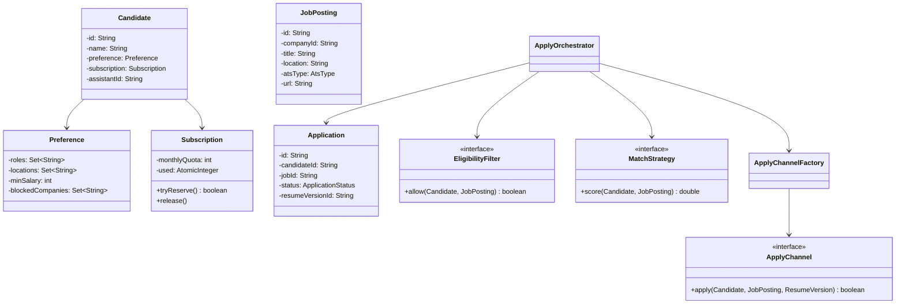

# Hiredeasy (Done-for-you Job Applications) — Reverse-Engineered LLD

> **Disclaimer:** This is not Hiredeasy's real code. It is a design inferred from what
> the product publicly says it does. Their stack and internals are not public, so read
> this as "how I would build it" in an interview.

## What the product does (public description)
- The candidate signs up and gets a **dedicated human assistant**.
- The assistant (helped by automation) applies to **250–1,200 jobs/month** for the candidate.
- They write **ATS-optimised resumes** and optimise the candidate's **LinkedIn** profile.
- They send **cold emails to hiring managers**.
- **AI agents watch company career pages** and apply as soon as a matching role goes live.
- The candidate sees their progress on a dashboard.

## FR
1. Candidate signs up, buys a plan (monthly application quota), uploads a resume and sets preferences.
2. System assigns a dedicated assistant to the candidate.
3. System ingests jobs from job boards and company career pages.
4. System matches jobs to each candidate's preferences.
5. The assistant (or an auto-apply bot) applies to matched jobs.
6. The system generates a tailored ATS resume or cover letter for each job.
7. Agents watch selected companies and trigger an apply when a new role is posted.
8. The system or assistant sends cold emails to hiring managers, with follow-ups.
9. Candidate dashboard shows applications, statuses, emails and interviews.
10. The system enforces the plan quota and stops applying when it runs out.
11. Candidate can approve or skip jobs, or set a blocklist of companies.

## NFR
1. **No duplicate applications** (same candidate + same job), since that hurts the candidate's reputation.
2. Quota correctness under concurrent apply workers.
3. Scraping/apply workers are horizontally scalable and retryable.
4. Rate limiting per job portal and per email domain, to avoid bans and spam flags.
5. Candidate PII and resumes stored securely.
6. Auditability: every application keeps proof (screenshot/confirmation).
7. Eventual consistency is fine for the dashboard.

## Core Entities
- Candidate
- Preference (roles, locations, salary, remote, blocklist)
- Plan / Subscription (quota)
- Assistant
- Company
- JobPosting
- Match
- Application
- ResumeVersion
- OutreachEmail
- WatchRule (company watcher)

## Relationships
```text
Candidate 1 → 1 Subscription
Candidate 1 → 1 Preference
Candidate N → 1 Assistant
Candidate 1 → N ResumeVersion
Company   1 → N JobPosting
Candidate 1 → N Match        N → 1 JobPosting
Match     1 → 0..1 Application
Application 1 → 1 ResumeVersion
Candidate 1 → N OutreachEmail
Candidate 1 → N WatchRule    N → 1 Company
```

## Probable High-Level Architecture
```text
                 ┌────────────── Candidate Web App / Dashboard
                 │               Assistant Ops Console
                 ▼
            API Gateway ── Auth
                 │
 ┌───────────────┼──────────────────────────────────────────┐
 │ Candidate Svc │ Billing Svc (Stripe)  │ Assignment Svc   │
 └───────────────┴───────────────────────┴──────────────────┘
                 │
   Job Ingestion (scrapers: LinkedIn/Indeed/Greenhouse/Lever/Workday)
                 │  JobPosted event
                 ▼
          Message Queue (Kafka/SQS)
        ┌────────┼─────────────┬───────────────┐
        ▼        ▼             ▼               ▼
   Matching   Watcher Svc   Resume Tailor   Outreach Svc
   Service    (career pg    (LLM + ATS      (email finder,
              diff)          keywords)       sequences)
        │        │
        └───┬────┘  ApplyTask
            ▼
     Apply Orchestrator ──► Human assistant queue
            │           └─► Auto-apply bots (headless browser per ATS)
            ▼
     Application Store + proof (S3) ──► Dashboard / notifications
```

## Main Flow — Apply to a job
```text
JobPosted event
   ↓
MatchingService scores job vs every active candidate preference
   ↓ score ≥ threshold, not blocklisted, not already applied
Create Match(PENDING)
   ↓
ApplyOrchestrator: reserve quota (atomic)
   ↓ reserved
ResumeTailor creates ResumeVersion for the job
   ↓
ApplyChannelFactory picks a channel:
   - known ATS (Greenhouse/Lever/…) → AutoApplyChannel
   - otherwise                    → HumanAssistantChannel (task in the ops console)
   ↓
Application SUBMITTED (with proof)  |  FAILED → release quota, retry/escalate
   ↓
Notify candidate, update dashboard
```

## Watcher Flow (agent on career pages)
```text
Scheduler every N minutes per WatchRule
   ↓
Fetch career page / ATS JSON feed
   ↓
Diff against last snapshot (hash of job ids)
   ↓ new job ids
Emit JobPosted(priority = HIGH)  → same matching/apply pipeline
```

## Patterns
| Pattern | Usage |
|---|---|
| Strategy | Matching/scoring strategy, resume tailoring strategy |
| Factory | Choose an `ApplyChannel` per ATS type |
| Chain of Responsibility | Eligibility filters (quota → blocklist → duplicate → score) |
| Observer / Pub-Sub | JobPosted, ApplicationSubmitted events |
| State | Application lifecycle |
| Template Method | Common apply steps per ATS bot (open → fill → upload → submit → proof) |
| Repository | Persistence |
| Facade | `ApplyOrchestrator` |

## Application State Machine
```text
PENDING → QUEUED → IN_PROGRESS → SUBMITTED → VIEWED → INTERVIEW → OFFER
                        │                         └──→ REJECTED
                        └──→ FAILED (retry ≤ 3) → ESCALATED_TO_HUMAN
SKIPPED (candidate rejected the match)
```

## UML


## Compact Java Code
```java
import java.util.*;
import java.util.concurrent.*;
import java.util.concurrent.atomic.*;

enum AtsType { GREENHOUSE, LEVER, WORKDAY, UNKNOWN }
enum ApplicationStatus { PENDING, IN_PROGRESS, SUBMITTED, FAILED, ESCALATED_TO_HUMAN }

class Preference {
    Set<String> roles, locations, blockedCompanies;
    Preference(Set<String> roles, Set<String> locations, Set<String> blocked) {
        this.roles = roles; this.locations = locations; this.blockedCompanies = blocked;
    }
}

class Subscription {
    final int monthlyQuota;
    final AtomicInteger used = new AtomicInteger();
    Subscription(int quota) { this.monthlyQuota = quota; }

    boolean tryReserve() {
        while (true) {
            int cur = used.get();
            if (cur >= monthlyQuota) return false;
            if (used.compareAndSet(cur, cur + 1)) return true;
        }
    }
    void release() { used.decrementAndGet(); }
}

class Candidate {
    String id; Preference pref; Subscription sub;
    Candidate(String id, Preference pref, Subscription sub) {
        this.id = id; this.pref = pref; this.sub = sub;
    }
}

class JobPosting {
    String id, companyId, title, location; AtsType ats;
    JobPosting(String id, String companyId, String title, String location, AtsType ats) {
        this.id = id; this.companyId = companyId; this.title = title;
        this.location = location; this.ats = ats;
    }
}

class ResumeVersion {
    String id, candidateId, jobId, content;
    ResumeVersion(String candidateId, String jobId, String content) {
        this.id = UUID.randomUUID().toString();
        this.candidateId = candidateId; this.jobId = jobId; this.content = content;
    }
}

class Application {
    String id = UUID.randomUUID().toString();
    String candidateId, jobId; volatile ApplicationStatus status = ApplicationStatus.PENDING;
    Application(String c, String j) { candidateId = c; jobId = j; }
}

// ---------- Matching (Strategy) ----------
interface MatchStrategy { double score(Candidate c, JobPosting j); }

class KeywordMatchStrategy implements MatchStrategy {
    public double score(Candidate c, JobPosting j) {
        double s = 0;
        for (String r : c.pref.roles)
            if (j.title.toLowerCase().contains(r.toLowerCase())) s += 0.7;
        if (c.pref.locations.contains(j.location) || c.pref.locations.contains("Remote")) s += 0.3;
        return Math.min(s, 1.0);
    }
}

// ---------- Eligibility (Chain of Responsibility) ----------
interface EligibilityFilter { boolean allow(Candidate c, JobPosting j); }

class BlocklistFilter implements EligibilityFilter {
    public boolean allow(Candidate c, JobPosting j) {
        return !c.pref.blockedCompanies.contains(j.companyId);
    }
}

class ScoreFilter implements EligibilityFilter {
    MatchStrategy strategy; double threshold;
    ScoreFilter(MatchStrategy s, double t) { strategy = s; threshold = t; }
    public boolean allow(Candidate c, JobPosting j) { return strategy.score(c, j) >= threshold; }
}

// ---------- Resume tailoring ----------
interface ResumeTailor { ResumeVersion tailor(Candidate c, JobPosting j); }

class LlmResumeTailor implements ResumeTailor {
    public ResumeVersion tailor(Candidate c, JobPosting j) {
        // In reality: LLM call + ATS keyword injection from the job description
        return new ResumeVersion(c.id, j.id, "Resume tailored for " + j.title);
    }
}

// ---------- Apply channels (Factory + Template Method) ----------
interface ApplyChannel { boolean apply(Candidate c, JobPosting j, ResumeVersion r); }

abstract class AtsBot implements ApplyChannel {
    public final boolean apply(Candidate c, JobPosting j, ResumeVersion r) {
        open(j); fillForm(c); upload(r); return submitAndCaptureProof();
    }
    void open(JobPosting j) {}
    abstract void fillForm(Candidate c);
    void upload(ResumeVersion r) {}
    boolean submitAndCaptureProof() { return true; }
}

class GreenhouseBot extends AtsBot { void fillForm(Candidate c) { /* greenhouse selectors */ } }
class LeverBot extends AtsBot { void fillForm(Candidate c) { /* lever selectors */ } }

class HumanAssistantChannel implements ApplyChannel {
    final BlockingQueue<String> opsQueue = new LinkedBlockingQueue<>();
    public boolean apply(Candidate c, JobPosting j, ResumeVersion r) {
        opsQueue.offer(c.id + ":" + j.id);   // assistant picks it up in the ops console
        return true;
    }
}

class ApplyChannelFactory {
    private final HumanAssistantChannel human = new HumanAssistantChannel();
    ApplyChannel get(AtsType t) {
        switch (t) {
            case GREENHOUSE: return new GreenhouseBot();
            case LEVER: return new LeverBot();
            default: return human;
        }
    }
}

// ---------- Orchestrator (Facade) ----------
class ApplyOrchestrator {
    private final List<EligibilityFilter> filters;
    private final ResumeTailor tailor;
    private final ApplyChannelFactory channels;
    // candidateId:jobId → Application ; putIfAbsent = dedupe
    private final ConcurrentHashMap<String, Application> applications = new ConcurrentHashMap<>();

    ApplyOrchestrator(List<EligibilityFilter> f, ResumeTailor t, ApplyChannelFactory c) {
        filters = f; tailor = t; channels = c;
    }

    Optional<Application> process(Candidate c, JobPosting j) {
        for (EligibilityFilter f : filters) if (!f.allow(c, j)) return Optional.empty();

        Application app = new Application(c.id, j.id);
        if (applications.putIfAbsent(c.id + ":" + j.id, app) != null) return Optional.empty();

        if (!c.sub.tryReserve()) {
            applications.remove(c.id + ":" + j.id);
            return Optional.empty();
        }

        app.status = ApplicationStatus.IN_PROGRESS;
        try {
            ResumeVersion r = tailor.tailor(c, j);
            boolean ok = channels.get(j.ats).apply(c, j, r);
            app.status = ok ? ApplicationStatus.SUBMITTED : ApplicationStatus.FAILED;
        } catch (Exception e) {
            app.status = ApplicationStatus.ESCALATED_TO_HUMAN;
        }
        if (app.status == ApplicationStatus.FAILED) c.sub.release();
        return Optional.of(app);
    }
}

// ---------- Career-page watcher (Observer) ----------
interface JobListener { void onJobPosted(JobPosting j); }

class CareerPageWatcher {
    private final Map<String, Set<String>> lastSeen = new ConcurrentHashMap<>();
    private final List<JobListener> listeners = new CopyOnWriteArrayList<>();
    void subscribe(JobListener l) { listeners.add(l); }

    void poll(String companyId, List<JobPosting> current) {
        Set<String> seen = lastSeen.computeIfAbsent(companyId, k -> ConcurrentHashMap.newKeySet());
        for (JobPosting j : current)
            if (seen.add(j.id)) listeners.forEach(l -> l.onJobPosted(j));
    }
}

public class Main {
    public static void main(String[] args) {
        Candidate alice = new Candidate("alice",
            new Preference(Set.of("Backend Engineer"), Set.of("Remote"), Set.of("acme")),
            new Subscription(250));

        ApplyOrchestrator orch = new ApplyOrchestrator(
            List.of(new BlocklistFilter(), new ScoreFilter(new KeywordMatchStrategy(), 0.5)),
            new LlmResumeTailor(), new ApplyChannelFactory());

        CareerPageWatcher watcher = new CareerPageWatcher();
        watcher.subscribe(j -> orch.process(alice, j)
            .ifPresent(a -> System.out.println(j.title + " -> " + a.status)));

        watcher.poll("stripe", List.of(
            new JobPosting("j1", "stripe", "Senior Backend Engineer", "Remote", AtsType.GREENHOUSE),
            new JobPosting("j2", "stripe", "Designer", "NYC", AtsType.LEVER)));
        watcher.poll("stripe", List.of(   // j1 already seen, so it isn't re-applied
            new JobPosting("j1", "stripe", "Senior Backend Engineer", "Remote", AtsType.GREENHOUSE)));
    }
}
```

## Cold Outreach (sketch)
```text
OutreachService
   ├─ ContactFinder (company domain → hiring manager email; pattern guess + verify)
   ├─ TemplateRenderer (LLM personalisation per job)
   ├─ Sequence: Day0 email → Day3 follow-up → Day7 follow-up; stop on reply
   └─ RateLimiter per sending mailbox (warm-up, ~30–50/day) + per recipient domain
```

## Concurrency & Correctness
- **Dedupe:** unique key `(candidate_id, job_id)`. In memory that is `putIfAbsent`; in a DB it is a
  `UNIQUE` constraint plus `INSERT … ON CONFLICT DO NOTHING`.
- **Quota:** an atomic CAS reserve, or in a DB:
  `UPDATE subscription SET used = used + 1 WHERE id = ? AND used < quota`. Release it on failure.
- **Idempotent workers:** queue messages carry an `applicationId`, so redelivery is a no-op once the application is `SUBMITTED`.
- **Rate limiting:** a token bucket per (portal, IP/proxy) and per mailbox.
- **Retries:** exponential backoff. After 3 bot failures the task is escalated to the human assistant.

## Likely Tech Stack (a guess, not verified)
| Layer | Plausible choice |
|---|---|
| Frontend | React / Next.js dashboard |
| Backend | Node.js or Python (FastAPI/Django) |
| DB | PostgreSQL (applications, quotas), Redis (rate limits, locks) |
| Queue | SQS / Kafka / BullMQ |
| Automation | Playwright/Puppeteer headless browsers, rotating proxies |
| AI | LLM API for resume tailoring, matching and emails |
| Email | Google Workspace / SendGrid with warmed-up mailboxes |
| Payments | Stripe subscriptions |
| Storage | S3 for resumes and screenshot proofs |

## Interview Navigation
```text
JobIngestion / CareerPageWatcher
    ↓  JobPosted
EligibilityFilters + MatchStrategy
    ↓
ApplyOrchestrator (dedupe + quota)
    ↓
ResumeTailor
    ↓
ApplyChannelFactory → AtsBot | HumanAssistant
    ↓
Application state machine → Dashboard
```

Most important deep dives:
1. No duplicate applications.
2. Atomic quota enforcement.
3. Bot-vs-human channel selection and escalation.
4. Career-page change detection.
5. Rate limiting so portals and mailboxes don't get banned.
